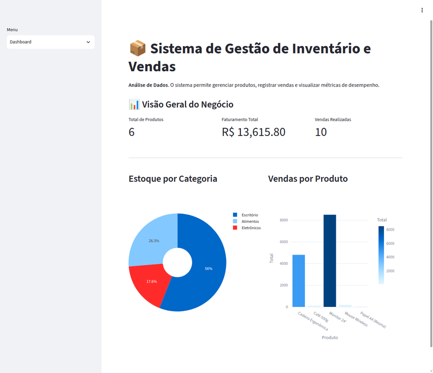
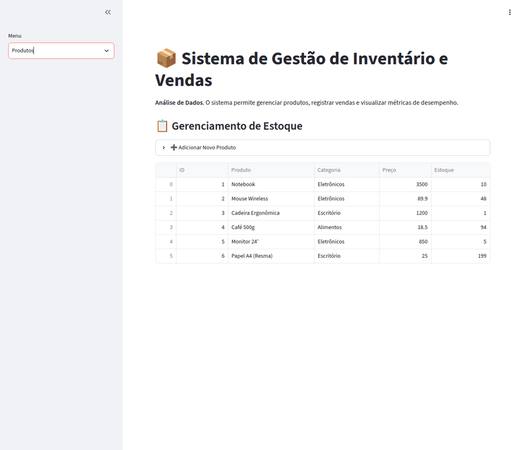
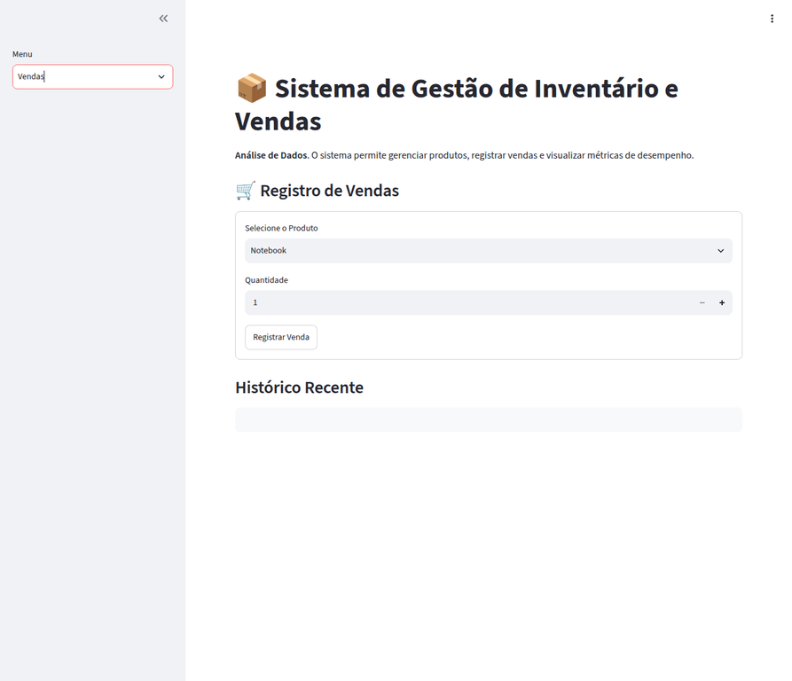

# Sistema de Gestão de Inventário Inteligente
Este repositório contém um dashboard local para cadastro de produtos e categorias,
controle de estoque e registro de vendas. O nome histórico do repositório inclui
“inteligente”, mas a aplicação implementa as funcionalidades descritas abaixo e
não faz uma promessa de inteligência artificial ou de previsão automática.

[](https://www.python.org/)
[](https://streamlit.io/)
[](https://www.sqlite.org/)

## O que existe

- Dashboard com total de produtos, faturamento e quantidade de vendas.
- Cadastro e consulta de produtos por categoria.
- Registro de vendas com validação de quantidade positiva e estoque disponível.
- Histórico de vendas e gráficos Plotly de estoque e faturamento.
- Persistência local em SQLite, com `PRAGMA foreign_keys=ON` em toda conexão.
- Seed de demonstração determinístico e idempotente.
- Tratamento visível de tentativa de categoria duplicada na interface.

O dashboard foi validado manualmente no ambiente de desenvolvimento e o workflow
também executa testes automatizados e um smoke test HTTP do Streamlit.

## Demonstração visual





## Como executar localmente

### 1. Clonar e instalar

```bash
git clone https://github.com/GustavoHCGit/sistema-gestao-inventario-inteligente.git
cd sistema-gestao-inventario-inteligente
python -m venv .venv
source .venv/bin/activate  # Linux/macOS
python -m pip install -r requirements.txt
```

Para executar testes e lint localmente, instale também:

```bash
python -m pip install -r requirements-dev.txt
```

### 2. Carregar dados de demonstração

O caminho padrão é `inventory.db`, na pasta do projeto. Para escolher outro
caminho, defina `INVENTORY_DB_PATH` antes de executar o comando. O seed pode ser
executado novamente sem duplicar as categorias, produtos ou vendas de demonstração:

```bash
python seed_data.py
```

Não há migração destrutiva automática. Se um banco antigo não tiver o esquema
esperado, a aplicação falha com uma mensagem de backup/migração manual e não
remove tabelas ou registros.

### 3. Iniciar a aplicação

```bash
streamlit run main.py
```

A aplicação abre em `http://localhost:8501`.

## Testes e lint

```bash
python -m pytest -q
ruff check .
```

Os testes cobrem vendas, estoque, quantidade negativa, duplicata de categoria,
foreign key, seed idempotente/determinístico e falha segura de esquema. O CI usa
Python 3.11 e 3.12.

## Tecnologias

| Tecnologia | Utilização |
| --- | --- |
| Python | Lógica da aplicação |
| Streamlit | Interface web interativa |
| SQLite | Persistência local |
| Pandas | Tabelas e agregações |
| Plotly | Gráficos |

## Estrutura

```text
.
├── main.py
├── database.py
├── seed_data.py
├── streamlit_init.py
├── tests/test_database.py
├── requirements.txt
├── requirements-dev.txt
├── .github/workflows/ci.yml
└── README.md
```

## Licença

MIT. Consulte [`LICENSE`](LICENSE).
